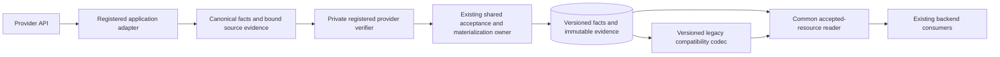

# Provider independence remediation plan

Version 1.4 — October 21, 2026. The owner approved continuation from completed Phase 1 into the first standings implementation and bounded local verification. The candidate and its evidence are tracked in the [implementation record](provider-independence-standings-implementation.md). Paid SQL qualification and release remain unauthorized. Three-phase delivery, streamlined verification, mandatory drift controls, all success criteria and the four-point handoff are unchanged. CP28 remains frozen.

## Decision for the owner

Keep the existing database, common fantasy concepts, accepted historical evidence, and shared application architecture. Complete the boundary between provider-specific interpretation and League One's shared storage and readers. The identified problem is that some common paths require Sleeper identity or native response structure, even after application normalization has occurred.

This is coordinated contract, identity, SQL acceptance, and reader work across the existing eight official-data families. It is not a database replacement. A format influenced by Sleeper is acceptable wherever its meaning represents the required facts correctly. No live Yahoo or ESPN connector, new public interface, additional season, or new competition model is included.

The implementation must meet this requirement:

> A registered adapter supplies League One facts and truthful source evidence. Shared storage and readers accept those facts without requiring another provider to impersonate Sleeper. Provider-specific validation remains owned by that adapter. Existing identities, historical records, integrity checks, and product behavior remain protected.

One refinement to the preceding discussion is essential: **native validation does not have to be physically removed from PostgreSQL to establish this boundary.** An adapter may include a private SQL verifier. The common persistence path must not make Sleeper's verifier or payload format universal. Simply deleting native parity checks would reduce protection and is not an approved remediation.

The recommended design retains independent database-side verification behind registered adapter interfaces. A stricter requirement that PostgreSQL contain no provider-format logic would require a separately designed external verification trust boundary; it is not silently assumed here. The decision and its consequence are recorded under D02 below. Documentation approval is not implementation approval.

## Documents and their authority

| Reference | Purpose |
| --- | --- |
| This plan | Scope, recommended design, work sequence, compatibility, CP28 impact, checkpoint reconciliation, and stopping rules. |
| [Source inventory](provider-independence-source-inventory.md) | Exact source baselines; confirmed findings; all-family writer, verifier, reader, and composition owners; candidate-specific overlap. |
| [Acceptance and evidence](provider-independence-acceptance.md) | Finite behavioral proof matrix, guard preservation, evidence requirements, and honest completion criteria. These are planned checks, not executed results. |
| [Architecture reference](../architecture-reference.md) | Wider application ownership and current behavior. This remediation narrows the changes within that architecture. |
| [Phase 1 shared design](provider-independence-phase1-design.md) | Selected shared contracts, identity/trust/storage/compatibility decisions and resolved source lineage. |
| [First standings specification](provider-independence-standings-design.md) | Complete first-slice field/object/guard/grant and adapter-to-reader design; planned assertions only. |
| [Phase 1 family coverage](provider-independence-phase1-coverage.md) | All-family dependencies, identity detail and finite evidence mapping; later family specifications remain open. |
| [First standings implementation record](provider-independence-standings-implementation.md) | Current bounded authority, exact dependencies and reviewers, candidate source, executed local evidence and unexecuted SQL qualification requirements. |

The original CP1–34 numbers and historical records remain unchanged. R1–R6 below identify six completion responsibilities delivered through three phases, not six sequential projects or replacement checkpoints. F, D, and Q labels identify findings, design decisions, and acceptance requirements. They create no independent execution campaigns or spending allowances. All eight family outcomes and Q01–Q16 remain required; this revision changes sequencing and evidence collection, not success criteria.

Latest explicit owner instructions govern scope. This plan does not edit the frozen CP28 plan, historical migration files, or existing checkpoint evidence. Historical 16-league/10 GiB scenarios remain historical; they are not a new mandate.

## Mandatory drift controls

These controls are required for every future authorized remediation increment. An increment is a reviewable unit of work toward an agreed outcome, not each file edit or tool call. The controls govern how existing success criteria are enforced; they add no feature, checkpoint, test campaign or execution authority. They must be applied during design, implementation, review and handoff, not reconstructed after a larger change has already been made.

| Control | Mandatory action | Enforcement |
| --- | --- | --- |
| Fixed finish line | Record the applicable plan version and source baseline. Keep R1–R6, all eight families, Q01–Q16, protected behavior and checkpoint objectives as the completion baseline. | An agent or reviewer may identify a defect but must not silently add, weaken or replace an outcome. A material amendment requires an explicit owner decision recorded before dependent work proceeds. |
| Specify each increment | Before its code, record the resource, existing path/files and database objects, intended persisted/read result, safeguards, required evidence, relevant R/F/Q/family requirements and known dependencies. Complete the applicable shared and slice design gates. | No implementation of an affected field, trust boundary, storage object or permission with an unresolved specification. Record directly necessary additional files/objects when discovered; a filename change alone does not require owner approval. |
| Deliver complete paths | Develop the selected adapter, acceptance, storage and reader together, including links where used. Keep the early real-boundary proof and existing shared architecture. | Do not replicate an unproved common mechanism across all families or introduce a parallel pipeline to avoid integration work. A partial path remains explicitly incomplete. |
| Trace every change | Connect every code, schema, permission, fixture and policy change to the specified increment and an existing requirement or demonstrated dependency. | Unrelated cleanup, speculative flexibility and “while we are here” improvements remain outside the increment. A new dependency follows the decision rule below before the affected work expands. |
| Control verification | Map each check to a requirement, changed dependency, diagnosed failure or mandatory workflow. Record the reason for repeating a passing check or adding a qualification case. | Follow the streamlined testing policy and existing execution limits. Finishing a step does not by itself justify a full rerun, new campaign, extra provider fetch or weaker assertion. |
| Protect completed work | Preserve original IDs, history, source-bound results and explicit deferrals. Identify the actual dependency that changes the applicability of earlier evidence. | Reopen only affected work with a recorded reason; a new finding cannot erase unrelated credit. Earlier passes and failures keep their original meaning. CP28 and its artifacts remain frozen. |
| Reconcile before closure | Review the actual changed files/objects, permissions, behavior and executed checks against the increment specification; provide the required four-point handoff. | An unexplained change, missing required evidence, unresolved material deviation or missing handoff prevents declaring that increment complete. Independent review must check this reconciliation where review is required. |

### Dependency and scope decisions

Before expanding the affected work, record a newly discovered dependency in the existing plan/coverage record: exact source evidence; the requirement it affects; the smallest necessary correction; affected files/objects, safeguards and earlier evidence; and any effect on product behavior, architecture, time, cost, execution limits or success criteria. Classify the decision and record its resolution. Use the existing record rather than creating a parallel tracking system.

- **Within the agreed scope:** routine implementation choices and necessary corrections may proceed within existing authority after completing their applicable design/review requirements. Explain the dependency and update the affected specification and evidence map. Do not ask the owner to approve every file or routine correction.
- **Material change:** a change to product scope, agreed architectural responsibilities or trust boundaries, agreed success criteria, unexpected cost or execution limits requires an explicit owner decision before the affected work proceeds. Weakening a required safeguard or acceptance assertion is material even if described as a test repair. Present the concrete finding, bounded proposal and consequences. Broader implementation or execution authority must never be inferred from a documentation update or an unrelated earlier approval.
- **Unresolved classification or a hard stop:** hold the dependent work while resolving it. Unaffected work may continue when its requirements and authority are clear. Existing source-identity, integrity and release stop conditions still govern.

A later family exposing a shared-design weakness must trigger this process and review of the affected earlier paths. It must not silently redefine the common contract or restart unrelated completed work.

### Mandatory four-point handoff

At each increment close, phase close, task transfer, or stop/interruption of remediation work, provide these four numbered items using the [detailed reporting template](provider-independence-acceptance.md#mandatory-four-point-handoff):

1. **Agreed requirement:** the outcome and scope being addressed.
2. **Actual change:** what changed, why and at which exact source/version.
3. **Evidence:** what supports completion, including failures, skips, unexecuted checks and limits.
4. **Unresolved items or deviations:** remaining work, scope differences, authority status and the next bounded action.

All four are mandatory, including for a partial or unsuccessful increment. State “none” explicitly where appropriate; never omit a category to imply success. Routine progress updates need not repeat the full handoff. An interruption that prevents immediate reporting leaves the handoff incomplete; the next resume must reconcile it before dependent work continues. Do not substitute an unexplained percentage-complete figure or a count of tests for accepted outcomes.

## Scope and protected behavior

Included changes are limited to source-qualified identity selection, real canonical write/read contracts, adapter-owned interpretation/verification, common acceptance/materialization, compatibility decoding, and affected evidence qualification.

The eight resource families are:

1. League identity, season configuration, and settings.
2. Teams, managers, ownership, co-ownership, and commissioner evidence.
3. Rosters, player-directory evidence, and player/defense identity links.
4. Exact-period matchups, lineups, and official score values.
5. Official standings, weekly reports, and their result facts.
6. Transactions, waiver/FAAB facts, and corrections.
7. Draft metadata, selections, and traded-pick ownership.
8. Brackets, schedules, and within-season history composed from accepted resources.

Schedules/results/history are partly compositions, not a requirement for three new storage systems. Native evidence and common facts may coexist. A provider need not have every optional field or a global player catalog to supply its supported facts.

| Preserve | Exclude from this remediation |
| --- | --- |
| Existing permanent IDs, canonical tables/concepts where semantics fit, mapping revisions, and source namespaces | Wholesale renumbering, database replacement, or renaming every Sleeper-related field |
| Original observations, captured payloads, immutable versions, receipts, corrections, and accepted-head ordering | Blanket historical backfill, synthetic new observation times, destructive cleanup, or changing retention |
| Existing source transports, admission/job owners, request budgets, deadlines, retries, and three cron schedules | New worker, queue, scheduler, feed, cache, or duplicate collection/publication path |
| Single scorer, Tank01 normalization, `clock-v1`, frozen baselines, snapshot builder and publication | New scoring rules, forecasts, analytics, or altered bye/missing-projection policy |
| Public routes, payloads, fallbacks, team/manager selection, browser polling, and league isolation | New-provider public routes, UI cutover, account product work, or fantasy-provider writeback |
| Source permissions, audience boundaries, restricted roles, account/auth isolation | Treating a provider code, parsed scope, or public username as access/ownership proof |
| Current bounded 2026 intake and explicit unknown/unsupported states | Annual traversal, prior-season intake, universal playoff/finality support, or fabricated official results |
| Frozen CP28 checkout, plan, receipts, failed attempts, and source-bound successful evidence | Resuming its campaign, resetting its allowance, activating its interners, or substituting new source under old approval |

The source audit found application-owned HTTP acquisition and no database-to-Sleeper HTTP mechanism in the inspected SQL/Neon code. This is a source finding, not a live database extension/network inventory. All stored-only readers and SQL remain network-free in the target design. Legitimate existing page fallback remains an application adapter call.

## Findings that require action

| Finding | Confirmed dependency | Required outcome | Owner |
| --- | --- | --- | --- |
| F01 | Common registration/selection writes or assumes Sleeper; a mapping lookup accepts only an external ID | Provider-qualified, registered source identity in registration and lookup | R1/R2 |
| F02 | Common reference paths constrain external team/matchup IDs to numeric shapes | Opaque source references without altering legitimate internal IDs or native Sleeper checks | R2 |
| F03 | Common writer still consumes a Sleeper administration envelope; some typed resources require specific native capture families | Versioned common facts with their own truthful evidence, verified through the registered adapter | R1/R3 |
| F04 | Common readers reconstruct Sleeper envelopes; common composition constructs source-specific references | Accepted common reads with explicit legacy codec dispatch and source-qualified composition | R5 |
| F05 | Catalog/link code selects Sleeper identity evidence by default | Provider-aware link selection using existing canonical identities, explicit unresolved/conflict states | R4 |
| F06 | Existing native parity, lineage, permissions and fences could be lost by a superficial generalization | Guard-by-guard preservation with non-bypassable verifier-to-writer flow | R3/R6 |
| F07 | Frozen CP28 changes the same receipt, link, population, provenance, and reader paths | Explicit candidate reconciliation and new source-bound proof before any final measurement | R6 and CP28 |

Exact examples and the effective SQL wrapper chain are in the source inventory. F01–F07 are grounded findings, not a claim that every occurrence of `sleeper` is a defect. Restricted Sleeper adapters, evidence versions, endpoint names, and native validation rules are legitimate.

## Recommended architecture

These are responsibilities within the existing application/database, not new services. The verifier may execute in PostgreSQL; it makes no provider request. Application acquisition still passes through the provider adapter. Existing admission, reservation, mapping and fencing determine who may submit which resource.

### Design decisions

| ID | Recommended decision | Why and limitation |
| --- | --- | --- |
| D01 | Reuse `ProviderReference`, observation evidence, accepted-resource concepts, and existing family values; define the actual production ingress/read DTOs | Existing types are useful but do not currently make the live writer generic. A type-only change cannot close F03. |
| D02 | Retain adapter-owned SQL verification as the lowest-risk transitional design; deny ordinary runtime access to the inner canonical writer | Preserves existing independent native checks without forcing Sleeper on every provider. This is provider-neutral shared persistence, not a promise of zero provider-aware SQL anywhere. Strict SQL-free native interpretation is an unresolved alternative, not an assumed requirement. |
| D03 | Use explicit, versioned, allowlisted provider/codec policies; only Sleeper is production-enabled | Arbitrary provider strings, runtime-selected function names, or test registrations must not create executable capabilities. |
| D04 | Retain old record formats and their exact codecs; introduce versioned common acceptance additively | Preserves immutable history and allows staged compatibility. No mandatory whole-history conversion. |
| D05 | Use one selected write path for a resource/capture/version and the same acceptance owner | No independent second ingest pipeline or duplicate provider fetch. Stored comparison may reuse one capture. |
| D06 | Keep new canonical SQL validation separate from native translation parity | Hash/lineage checks bind records; they do not prove translation semantics. Each family retains the actual protection it has today. |
| D07 | Keep native evidence tables explicitly native when their restrictions describe true source evidence | Generalize the common fact/reference path, not every table indiscriminately. Existing table names do not determine semantics. |
| D08 | Phase 1 selects the complete coherent `8f026c2…` source, including unchanged 063–065 and compatible readers/provisioning, for a separate future implementation worktree; append forward migrations from 066 after fresh reconciliation | The actual migration runner requires contiguous numbers. Published `168a856…` remains the comparison reference; 062 → 066 is not an installable base. Preserve the original frozen CP28 checkout/artifacts; shared capture/interner bindings remain inactive. Carrying source is not execution or qualification. |

D01–D08 are selected and detailed in the [Phase 1 shared design](provider-independence-phase1-design.md), with independent review and readiness recorded there. The exact source, identity, evidence, trust, compatibility, migration-lineage and first-slice decisions must be reconciled before code authoring. Before each later slice, review its exact field/object/guard/grant specification and shared dependencies. A slice is a complete adapter-to-reader path for selected facts, including acceptance and links where used. If D02 conflicts with an intended requirement that no native-format verifier exist inside PostgreSQL at all, stop for that material architecture decision. Do not substitute an unreviewed signing/key service or silently weaken verification.

### Canonical delivery contract

The canonical delivery is not arbitrary JSON with a different label. Each supported family/version must have a complete field specification and validation rules before its writer is authored.

| Contract group | Required information and interpretation |
| --- | --- |
| Source identity | Registered provider, resource kind, namespace, exact opaque native ID, connection and canonical league/season/entity IDs as applicable |
| Requested scope | Family, exact native period and evidenced canonical period mapping where available, audience/access context, coverage policy, source-mapping revision |
| Canonical meaning | Existing typed family facts, units, decimal policy, source authority, ordering/cardinality, native extension references, and explicit missing/null/empty/invalid/unknown states |
| Versions | Canonical schema version, adapter/normalizer version, native verifier version and acceptance policy version; each has one defined job |
| Evidence | Retained source-content reference and its current hash convention; canonical-content reference/hash; capture/observation identity; native revision if actually supplied |
| Time | Request start/completion, original source observation/update time when known, check time, normalization time, and origin: network/cache/retained replay/bootstrap |
| Completeness | Full/subset/unknown entity scope, pagination state, period coverage, field coverage, explicit reasons and supported removal semantics |
| Write authority | Original reservation/attempt, acquisition witness where required, worker/generation, deadline/lease, mapping and caller permissions |
| Acceptance result | Existing changed/unchanged/replayed/stale/rejected outcomes; accepted content/receipt/generation and coverage; no fabricated successful observation |

Preserve the captured representation and its versioned hashing convention. A parsed JSON payload is not retroactive proof that original wire bytes or JSON lexical formatting were retained. Do not change an old content hash definition or claim stronger provenance than the capture supplies.

Same facts and same content are not necessarily the same observation. An unchanged successful capture may create its own evidence; a replay must not invent one. Sharing content cannot merge source identities, acceptance receipts, observation times or authority.

### Verification and privilege boundary

Recommended invocation is an allowlisted adapter entry that verifies the native/canonical pair and delegates within the same transaction to common acceptance. Runtime cannot call the inner common write function or alter verifier registration directly. The provider/codec selection must be bound to the registered connection and resource; it cannot be taken from an unchecked function name in a request.

For an existing Sleeper path, retain its independent native checks until the corresponding verifier reproduces them and the common materializer preserves the same accepted result. A legacy wrapper may delegate unchanged while its family transition is qualified. New canonical facts must not bypass acceptance merely because a legacy envelope was accepted.

Shared SQL retains canonical field validation, foreign keys, scope/mapping/audience checks, original capture binding, request chronology, generation/deadline checks, replay rules, immutable content/collision checks, correction order, typed child closure, and atomic head advancement. Recheck ownership after any lock wait as existing policy requires.

Materialization must be validated against the canonical payload, including child counts and full values. Native-to-canonical parity remains the adapter verifier's separate responsibility. `verified: true`, matching hashes, or calling the same application normalizer twice cannot replace independent parity validation. Current transaction SQL has weaker native semantic checking than some other families; the plan must not claim all legacy families already had identical assurance.

The existing acquisition witness is also not cryptographic proof of a remote provider's identity. Preserve its actual guarantees rather than introducing an unrelated authentication infrastructure project.

### Storage and old data

Before changing an object, produce its storage decision from the inventory: retain as native evidence; reuse as common fact storage; extend with a versioned contract; or add the smallest necessary canonical relation. Resolve shared objects and known cross-family dependencies in phase 1; complete family-specific detail before that family's slice is authored. Each changed constraint/function needs an identified old guard, replacement owner, role grants, index/read effect and Q requirement. This is required engineering design, not permission for a new schema architecture.

Existing IDs and immutable records retain their meaning. No blanket data migration is assumed. Legacy decoding selects the recorded provider and codec version; it does not relabel old data as newly acquired canonical evidence. If a specific reader needs historical canonical materialization, propose only that bounded slice with old/new lineage preserved and explicit replay semantics.

Do not generalize a native-only evidence table merely because it has a numeric-ID constraint. First establish whether the common path incorrectly depends on that table. Keep valid native validation and provide a truthful common representation. Native roster-derived standings can continue using their original capture; another adapter's standings receipt must describe its actual source, not a fake roster response.

### Reads and composition

Common readers decode accepted canonical records and check scope, version, evidence, authorization, coverage and freshness. Legacy data goes through its versioned compatibility codec. Invalid canonical evidence must be surfaced; falling back to a legacy/current head must not hide a conflict or imply a failed collection succeeded.

Shared transaction ordering, matchup grouping, standings, schedules and history joins consume source-qualified facts. Native transaction status/time parsing, bracket interpretation and provider-local period mapping stay in their adapter codecs. Current bounded season/period policies remain explicit inputs; this does not expand the permitted 2026 acquisition range or invent finality.

Existing public Sleeper facades can keep their current payloads and URLs during this backend repair. Future-provider public access is a separate compatibility decision. Backend portability is not a claim that the current `sleeper-*` routes or numeric manager URLs already expose another provider.

## Completion responsibilities and exit criteria

These responsibilities remain individually accountable. Dependencies below apply to the selected slice; they do not require finishing every family's writers before beginning any reader. Final closure still requires every family and applicable guard.

| Responsibility | Concrete deliverable | Dependency and timing | Exit condition |
| --- | --- | --- | --- |
| R1 Contract and policy | Field-level contract for each family; provider/codec selection and trust model; complete old-guard disposition | Exact source inventory | D01–D08 recorded; no required field/trust/ownership ambiguity; independent review of guard parity |
| R2 Identity | Source-qualified registration, mapping and enrollment selectors; opaque common references | Shared R1 decisions and complete specification for affected identities | Cross-provider identical IDs cannot collide; old canonical IDs/aliases remain; unknown provider fails explicitly |
| R3 Acceptance | Adapter verification entry, shared canonical acceptance/materialization, controlled grants and migration specification | Complete R1 specification and required R2 identities for this slice | Every affected guard preserved or explicitly justified; standalone standings evidence works; no runtime bypass to inner writer |
| R4 Entity links | Provider-qualified directory, roster/draft player links and existing crosswalk integration | Relevant R1/R2/R3 paths; developed with the slices that consume links | Correct source namespace; no forced Sleeper catalog, name-based identity guess, or changed historical link meaning |
| R5 Reads and compatibility | All-family canonical readers/common composition; versioned legacy codecs; existing public facade preservation | Developed with relevant R3 acceptance; R4 prerequisite only where links are consumed | Complete family matrix passes; old/new coexist; stored reads require no provider acquisition |
| R6 Integration evidence | Exact candidate/dependency/guard mapping, finite affected qualification, CP26–30 evidence impact and CP28 reconciliation | Starts with R1 planning; accumulates per slice; closes after R1–R5 and final-source reconciliation | No unresolved required case; explicit source/measurement limits; original CP28 artifacts unchanged |

R1 has a shared design gate and a complete specification for each family. It remains partially open until all family specifications are complete; phase 1 is not global R1 completion. Reuse exact existing type/schema/version references for unchanged meanings, and explicitly document every changed meaning, constraint, guard and permission. No slice may be coded with unresolved field, trust, storage or privilege decisions that affect it. A later change to a shared decision reopens the affected dependency review and evidence, not unrelated completed work. Routine choices within the approved scope do not reopen the product vision.

Each implementation increment records the original DATA contract's four fields: resource, existing path/files, persisted result, and actual evidence/gaps. Do not use a large unspecified “shared backend” exception. A new file/table/role/endpoint requires its direct relationship to one of R1–R6 to be recorded.

## Three-phase delivery

The phases organize implementation and qualification once separately authorized. They are not three monolithic changes, three test runs, new checkpoints, or release authority. Use reviewable increments within each phase and retain required verification before any merge.

The [mandatory drift controls](#mandatory-drift-controls) apply to every increment in every phase. Phase advancement requires the relevant exit evidence and completed handoff; changing delivery grouping never changes the finish line.

| Phase | Work delivered together | Exit condition |
| --- | --- | --- |
| 1. Set the shared rules | Shared R1 decisions; all eight families' owners, known dependencies and guard destinations; source/migration lineage and CP28 disposition; R6 coverage and bounded execution planning; first slice's complete specification | Shared decisions and first slice field/object/guard/grant design independently reviewed. Every family remains in the completion inventory. No unresolved shared trust, identity, privilege or migration dependency is deferred into code. |
| 2. Build complete paths incrementally | Complete each next family's R1 detail before its code; implement relevant R2 identity, R3 acceptance, R4 links and R5 reading together; collect R6 evidence as each path becomes executable | Every family has its complete specification and implementation, with relevant targeted and actual-SQL evidence recorded under its authority. No unproved common acceptance mechanism is replicated across all families. Partial early success is never reported as all-family qualification. |
| 3. Qualify the integrated candidate | Reconcile all R/F/Q/family coverage and source dependencies; run required complete verification, CI and preview checks; obtain distinct CP26–29 evidence and assemble CP30 | All R1–R6 exit criteria and eight-family/Q01–Q16 requirements met for their actual candidate/dependencies; each operational checkpoint separately evidenced. CP31–34 remain subsequent, separately authorized actions. |

Phase 1 resolves the relationship with the frozen 063–065 overlay in D08 and the shared design. It neither changes nor activates CP28. The coherent unchanged overlay is carried into a separate future candidate; all forward migrations remain unauthored and the original source/evidence preservation rules remain in force.

Phase 2 begins with the minimum legitimate identity/settings/team prerequisites and a standalone standings path. A registered synthetic provider uses opaque league/team IDs, its own standings response and truthful receipt, actual restricted-role verification, common acceptance/materialization, and stored-reader readback. Retained Sleeper roster-derived standings traverse the corresponding common contract, with legacy reads and original evidence preserved. Include cross-provider ID collisions, mismatched translation, attempted verifier bypass, correction and replay. Prerequisites must not seed preaccepted facts that bypass the path under examination.

Qualify that first actual SQL boundary under the existing guarded harness and applicable execution authority before extending the same mechanism to every family. Follow it with a small complete roster/player-link path using another player namespace without a required Sleeper catalog; preserve unresolved/conflicting identity states. These are early increments of the required implementation, not throwaway prototypes or additional campaigns. They do not qualify other families by analogy.

Extend through the remaining settings/team relationships, matchup/point and report paths, transactions, drafts/picks, and bracket/history compositions according to their real dependencies. Each selected slice includes its writer and reader; links accompany the slices that need them. Complete cross-family history only after its required resources are covered. The exact slice grouping is recorded in phase 1 and refined only for documented dependencies, without changing the eight-family scope.

Early results retain their original source identity. Final evidence may reuse them only with the explicit dependency rationale in the [streamlined testing policy](provider-independence-acceptance.md#streamlined-testing-policy); no original run is relabelled as a new candidate pass. Known later changes to the common boundary must be resolved before final operational measurements.

## Checkpoint reconciliation and order

| Existing checkpoint | Recorded status | Treatment under this plan |
| --- | --- | --- |
| CP3 and CP4 | Deliberately deferred annual linking and prior-season discovery | Remain deferred. Provider-neutral references do not authorize traversal. |
| CP5–25 | Accepted bounded outcomes at their historical sources, including later successful CP20/24/25 closeouts | Preserve credit and exact evidence. Requalify affected dependency paths; do not declare them all skipped or silently transfer every pass to changed code. |
| CP26 | Stopped/incomplete; narrowed 60-second complete 1–4-league useful current import, identical replay and current-batch ownership/recovery | Complete the changed boundary first, then address the confirmed pre-draft/no-matchups case and obtain the narrow final-source proof under new applicable execution authority. |
| CP27 | Deferred/unqualified after failed measurement | Preserve diagnostics/query inventory; measure actual final integrated readers. No evidence means unproven performance, not automatically slow performance. |
| CP28 | Incomplete; original focused measurements accepted; final local candidate frozen/unexecuted | Resolve direct dependency and source integration before proposing new measurement. Preserve frozen originals; no automatic continuation. |
| CP29 | Restore/replay qualification remains | Prove final schema's history, receipts, heads, identities and readers survive isolated restoration. |
| CP30 | Coherent release candidate/review remains | Reconcile exact source, ordered migrations, grants, affected evidence, preview and install/disable/recovery plan. |
| CP31–34 | Separate installation, merge, deployment/activation and production verification | Retain separate authorization and evidence gates. CP30 is not release permission. |

The CP26 amendment deferred sustained fleet freshness, full-history/backlog throughput, prolonged outage and daily/endurance testing. Do not reintroduce them as hidden conditions of narrowed CP26. Conversely, a narrow import pass does not establish those operational guarantees.

For CP26's pre-draft failure, do not manufacture matchups or omit a discovered league. Determine whether truthful unavailable/not-ready states satisfy the existing approved reader requirement. If that requires changing the acceptance requirement rather than fixing its implementation, record the conflict for an explicit scope decision before rerunning.

Sequence: phase 1 shared design and evidence planning; phase 2 complete family paths with each detailed specification preceding its code and targeted proof alongside it; phase 3 final-source reconciliation and qualification. Fix the narrow CP26 behavior during the affected implementation slice, then obtain its final-source proof; obtain CP27 and CP28 evidence for the integrated design; complete CP29 and CP30; then, only as authorized, CP31–34. R6 operates throughout and closes at final reconciliation. CP27/28 planning can occur together, but measurements must not certify a writer/reader already scheduled for replacement.

This order is driven by confirmed shared paths, not a blanket rule to finish every future-provider improvement before CP28.

## CP28 dependency decision

The source inventory confirms direct overlap; the question is no longer whether the areas touch at all. The amount of reusable CP28 code and evidence remains a candidate-integration decision.

| Frozen candidate area | Overlap | Required disposition before later execution |
| --- | --- | --- |
| 063 roster-link contents | Provider aliases, catalog selection, link representation, mapping/receipt identity; shared capture remains unbound | Compare R2/R4 representation and guard changes; reuse only compatible semantics; qualify changed link acceptance |
| 064 roster population | Population evidence, receipt accessors, writer wrappers, lineage and standings coverage; interner remains unbound | Preserve coverage and legacy accessor behavior; decide whether revised common population can reuse this design |
| 065 roster provenance | Provenance content, writer/lineage/standings checks, intake checkpoints, resource reconciliation and request-budget settlement | Trace every consumer of changed evidence; do not treat this as only a byte-saving change |
| Compatible reader changes | Current roster, managers, links, standings, period context and official results | Never copy accessor-dependent readers without the corresponding installed migration/version |
| Frozen measurement plan | Four selected core cases, two leagues ×20 teams; separate final candidate accounting | Preserve plan and hashes. It is not all-family qualification or a 41×12 fleet measurement; new candidate needs its own source binding and explicit execution authority |

Phase 1 resolves source assembly by carrying the complete unchanged `8f026c2` overlay into a separate future candidate and appending forward migrations. Its new shared capture/interner bindings remain inactive; its existing function/accessor replacements are operative dependencies, not dormant SQL. The contiguous production migration runner prevents silently skipping 063–065. Earlier A/B1 and combined A+B evidence remains accepted within its original source and scope; the final frozen candidate remains unexecuted. No old migration is edited and no historical result is transferred to changed code. The [shared design](provider-independence-phase1-design.md#exact-sources-and-migration-decision) records the exact dependency, smallest correction and evidence implications.

The planning population of 41 leagues ×12 teams does not determine player counts, change frequency, season length, corrections, drafts, histories, query mix or capture cadence. CP28 must state those inputs and uncertainty. No 10 GiB ceiling or measured fleet capacity is imposed by this document. Storage targets and spend are separate owner decisions, not a reason to delete evidence.

## Migration, enablement and recovery sequence

1. Revalidate local/GitHub main, candidate lineage, Vercel binding/production SHA and relevant ownership before implementation and again before deployment. Source files do not establish installed database state.
2. Review the exact ordered migration set, function replacements, privileges and old/new object compatibility. Qualify installation through the existing isolated harness; no production experiment.
3. Install additive compatibility/read support before selecting a new write representation. Existing legacy paths remain supported within the explicitly verified compatibility window.
4. Enable one qualified adapter/family/version at a time only when authorized. The same acquisition/capture feeds comparison; it must not create another provider request or publish a second independent result.
5. After new records exist, retain readers that understand both versions. A rollback to code unable to read new records is prohibited by the compatibility contract.
6. To disable, stop new selected DATA admission through existing controls; fence or drain in-flight work using existing ownership. Do not delete receipts, reset campaign counters, indiscriminately clear leases, or remove accepted history.
7. Continue serving qualified retained data with truthful freshness. Revert code only within the proved compatibility window; otherwise use the reviewed forward fix. A full database restoration cannot discard newer valid account/league data as routine rollback.
8. CP29 restores final schema/data in isolation and checks legacy/canonical readers and replay. Provider re-fetch alone is not restoration of immutable history.

CP29's historical targets are at most 24 hours of committed accepted data loss and at most four hours to verified restored-reader service. These are targets, not observed results or permission for a four-hour test. The existing harness duration/cost limits still govern; a bounded executable restore plan must reconcile them explicitly.

## Evidence and carry forward

Use the finite [acceptance matrix and streamlined testing policy](provider-independence-acceptance.md#streamlined-testing-policy). Maintain one assertion-to-R/F/Q/family coverage map. Use targeted checks during development and reviewed, bounded groups sharing fixture/setup only where isolation and required state permit. Exercise the first real SQL boundary early; retain distinct verifier, materializer, permission, concurrency and legacy-read proof. Reuse existing harnesses and valid retained source fixtures; do not launch all historical campaigns again by default or create a separate testing-framework project.

Plan the complete required workflow for a stable integrated candidate, retaining required checks before any merge and all mandatory CI/preview evidence. Do not run `verify` immediately before `verify:full` on unchanged source merely by habit: the latter already includes it. Account for its configured default SQL invocation so a selected qualification does not accidentally schedule a duplicate or unauthorized run. Do not hide a configured gate or treat skipped SQL as qualified. Repeat successful checks only when relevant changes, failures, unresolved concerns or required workflow obligations justify them. The companion policy defines evidence reuse and rerun triggers; no fixed run count, time saving or new execution allowance is implied.

Carry-forward records identify original source/result, changed dependency, reason for continued applicability, and required new proof. Identical file bytes alone are insufficient when an invoked SQL function or contract changed. A failed old attempt remains failed; an accepted old attempt remains valid for its original scope.

Ordinary source checks, actual restricted-role SQL qualification, preview behavior, performance, storage measurement, restoration and production activation are separate evidence classes. None substitutes for another. No result is invented because a test exists in source or a table has been created.

## Stop conditions and decisions still required

| Condition | Required response |
| --- | --- |
| Unexplained source/service identity disagreement or unresolved migration order | Stop implementation/release work until reconciled; do not guess which candidate is authoritative. |
| D02's adapter-owned SQL verifier conflicts with the owner's intended boundary | Resolve that architecture decision before authoring; retain current guards meanwhile. |
| Missing field-level contract, guard destination, verifier bypass protection, or privilege specification | Block the affected slice until its specification is complete; unresolved shared trust/source/privilege decisions block all dependent work. R1 remains open until every family is specified; this document alone is no implementation claim. |
| Unmapped change, missing four-point handoff, or unresolved material deviation | Do not declare the increment complete or advance dependent work on assumed completion. Reconcile scope and evidence; obtain an explicit owner decision for a material amendment. Continue only clearly unaffected authorized work. |
| A required official fact cannot be represented honestly | Document the exact resource limitation; do not invent a value or broaden all competition support. |
| Old history becomes unreadable; source IDs collide; private scope leaks; receipt/hash/clock meaning changes | Reject the change and repair its cause before qualification. |
| New provider request owner, duplicate acquisition, changed cadence, new sustained cost, or extra pipeline | Stop and establish whether a bounded correction can preserve scope; expanded architecture is not implicit authorization. |
| Proposed deletion, history rewrite, secret retrieval, live-provider run, paid qualification or production action | Requires the applicable separate authority; this documentation task provides none. |
| Failed qualification | Record the actual failure, stop at the predeclared limit, investigate the root cause; no automatic retry/reset, denominator change or weakened assertion. |

## Confidence and completion statement

The source findings, family ownership, historical checkpoint statuses and direct CP28 overlap are supported by inspected code/evidence. This plan makes the intended boundary and preservation requirements explicit. It cannot certify that an unimplemented migration, independent verifier, or compatibility transition works.

The plan is ready to serve as a reviewable remediation specification. The three-phase organization preserves all six R exit criteria, eight family outcomes, Q01–Q16, and existing checkpoint obligations. Shared design readiness, individual slice readiness, full R1 completion, implemented behavior and operational qualification are separate states. Phase 1 now supplies the shared design and first standings specification; later-family R1 detail, implementation, actual SQL behavior, performance, storage and recovery remain future engineering work with explicit exit criteria. No unsupported duration estimate or guarantee of every future provider is made.

### Documentation review record

Three independent read-only agent reviews covered this plan and its two companion documents on October 21:

| Review scope | Disposition |
| --- | --- |
| SQL ownership, native verification, privilege boundary and CP28 function overlap | No material documentation defect found; detailed R1 design and actual execution proof remain open. |
| All-family coverage, common/legacy readers, product compatibility and finite qualification | Accepted documentation scope after clarifying abbreviated source paths. No new provider or UI work added. |
| Checkpoint sequence, historical evidence, source-base strategy, rollback and CP28 freeze | Accepted documentation consistency after correcting wording that had grouped earlier measured 063/064 work with the unexecuted final candidate. Earlier accepted evidence retains its original credit. |

These are reviews of the source-backed plan, not independent certification of deployed behavior. Document links and whitespace were checked; no application tests, SQL execution, provider acquisition or production changes were performed.

The version 1.1 amendment received a separate read-only consistency review of phased design gates, integrated slices, continuing R6 evidence and the streamlined testing policy. Direct document comparison confirms the six R deliverables/exit criteria, eight-family and Q01–Q16 acceptance tables, protected behavior, source findings, checkpoint outcomes and CP28 preservation requirements are unchanged. The amendment authorizes documentation only.

Version 1.2 adds mandatory drift controls and the four-point handoff. Independent read-only review found no material defects; document comparison confirms the architecture, six R requirements, eight-family/Q01–Q16 proof, checkpoint outcomes and CP28 protections are unchanged. No implementation or tests were authorized or performed.

The v1.2 documentation is uncommitted work on `codex/architecture-reference`, based on commit `87da4d0cb909ee280e125e73ad10e1c3dbd7cd9f` and committed tree `a32e1b924432261bfca5f1a198c02a855ff6ff20`. Those Git identities describe the base, not the uncommitted documentation. The reviewed artifacts are this v1.2 plan, its v1.2 acceptance and source-inventory companions, and the README links to the mandatory controls and handoff.

At handoff, the original architecture-reference changes and this documentation package are local to `codex/architecture-reference`. Application source, tests, migrations, provider/cron configuration, production records, and frozen CP28 artifacts are unchanged. Publication, merge and deployment are not performed.

Version 1.3 records the completed Phase 1 design increment. The [shared design and mandatory handoff](provider-independence-phase1-design.md#readiness-and-handoff-record), [first standings specification](provider-independence-standings-design.md) and [family coverage](provider-independence-phase1-coverage.md) resolve the implementation boundaries and planned first proof. Independent fresh-read review found no material design blocker after correcting source lineage, identity/admission constraints, witness/lock/receipt bindings and reader semantics. D08's changed source recommendation is explicit; original CP28 source, hashes, authority and results remain frozen. R1–R6 success criteria, eight family outcomes, Q01–Q16 and checkpoint objectives are unchanged. This closes shared/first-slice design readiness only; full R1, all implementation and runtime/operational qualification remain open. The v1.3 package is local/uncommitted documentation, with no implementation, tests, publication, merge or deployment performed.

Version 1.4 records the subsequent human “Approved to Continue” following the Phase 1 handoff's proposed next step: implement the first standings slice with its minimum identity prerequisites and bounded verification. Phase 2 is in progress for that slice only. The design-only statements in the preceding review records describe those completed increments; they do not cancel the later authorization or grant paid SQL/provider/release authority. The original architecture-reference package and CP28 checkout are preserved separately. No R1–R6, family, Q or checkpoint outcome is marked complete by this status update; actual database behavior still requires its scoped proof.
