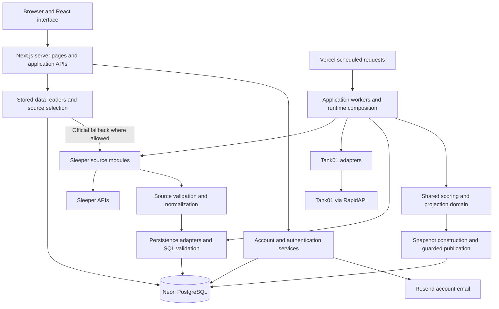

# League One architecture reference

League One brings a manager's fantasy football teams into one application, preserves official provider data, and adds projections and analysis where supported. This reference locates the product features, data collection, calculations, storage, account flows, and operational controls that make that possible.

The provider adapter boundary is partly complete. Application code owns provider requests, and the database does not fetch Sleeper data in the audited source. Some persistence and reader code still interprets Sleeper payloads. The existing common data structures remain useful; completing this boundary does not imply replacing the database.

The [provider independence remediation plan](aggregator-backend/provider-independence-remediation.md) defines the proposed changes, source inventory, integrity protections, compatibility and checkpoint dependencies. Its [three-phase delivery](aggregator-backend/provider-independence-remediation.md#three-phase-delivery) carries the same six R1–R6 completion requirements through coordinated work, rather than six sequential projects; the [streamlined testing policy](aggregator-backend/provider-independence-acceptance.md#streamlined-testing-policy) combines evidence collection without reducing success criteria. Adapter-owned native validation may remain in SQL; shared paths must not require every provider to supply Sleeper-shaped evidence. Implementation and CP28 execution remain unauthorized.

## How to use this reference

Start with the system map and responsibility tables. Use the source links to locate an implementation and the linked operating documents for its detailed rules. This is a map of functional ownership, including the entry points for supporting modules; it is not an inventory of every private helper function.

Quick navigation: [product](#product-features-and-their-owners) · [providers](#provider-acquisition-and-normalization) · [workers](#scheduled-work-and-manual-operations) · [calculations](#calculations-and-publication) · [database](#database-records-and-their-purposes) · [readers/caches](#stored-reads-and-browser-refresh) · [accounts](#accounts-onboarding-and-private-data) · [routes](#route-catalog) · [DATA/CP28](#unreleased-data-collection-and-storage) · [operations](#hosting-security-and-engineering-operations) · [vision/gaps](#vision-current-boundary-gaps-and-change-placement).

Status labels have precise meanings:

| Label | Meaning |
| --- | --- |
| Main | Present in the main source baseline. Configuration-dependent features still require activation. |
| Gated | Implemented, but a flag, credential, accepted enrollment, or other explicit qualification controls use. |
| Internal | Implemented for shared readers or comparisons; public pages have not necessarily switched to it. |
| DATA | Implemented on the unreleased DATA branch, separate from production main. |
| Frozen | Local CP28 candidate work; not authorization to execute, activate, or deploy it. |
| Planned | Architectural direction or future provider support, not an implemented capability. |

The source baseline and deployment observation are recorded in [Source baseline](#source-baseline). Relative links refer to main. Links labeled DATA use the published DATA source snapshot. Features are not considered active merely because their implementation exists.

## System map

These boxes are code responsibilities, not separately deployed microservices. The web server, API handlers, provider adapters, and workers live in the same Next.js application under `apps/site`. Vercel schedules authenticated HTTP requests into that application. Neon is the database service. A worker is a bounded application invocation, not an always-running process.

The target provider flow is **provider API → provider adapter → League One records → shared persistence → shared readers and features**. The current acquisition direction matches this flow, while native interpretation also remains in some SQL and read modules. Raw provider evidence may be retained alongside common facts without making the common format incorrect.

## Responsibility boundaries

| Responsibility | Where it belongs and currently runs | Principal source |
| --- | --- | --- |
| Interface interaction | Browser: tabs, expansion, selected week/team, formatting, scoped polling, and presentation calculations | [Components](../apps/site/components) |
| Page assembly and request handling | Next.js server: routing, registry resolution, source selection, authentication, response construction | [Application routes](../apps/site/app), [shared league pages](../apps/site/components/league-pages.tsx) |
| Official fantasy data | Sleeper is authoritative for supported league identity, rosters, lineups, scores, standings evidence, transactions, drafts, and brackets | [Sleeper source](../apps/site/lib/sleeper.ts) |
| Provider acquisition and translation | Application-side provider modules; separate resource-specific functions are valid parts of the adapter boundary | [Sleeper adapters](../apps/site/lib/projections/adapters/sleeper), [administration normalizer](../apps/site/lib/league-administration/normalize.ts) |
| Projection statistics and game state | Tank01 adapters acquire statistics, crosswalks, and clocks; Tank01 does not own league-specific fantasy scoring | [Tank01 adapters](../apps/site/lib/projections/adapters/tank01) |
| League One calculation policy | Shared domain: canonical scoring, live projection policy, win probability, and feature coverage | [Projection domain](../apps/site/lib/projections/domain), [capabilities](../apps/site/lib/league-capabilities.ts) |
| Scheduling and orchestration | Application runtime and workers select due work, coordinate sources, acquire leases, and publish | [Runtime composition](../apps/site/lib/projections/runtime), [workers](../apps/site/lib/projections/worker) |
| Persistent records and write integrity | Neon stores identities, evidence, history, leases, baselines, and snapshots; SQL validates relationships and ownership | [Migrations](../apps/site/migrations), [Neon adapters](../apps/site/lib/projections/adapters/neon) |
| Read selection and freshness | Server readers select the exact league/period and decide whether evidence is usable | [Projection reader](../apps/site/lib/projection-reader.ts), [page source](../apps/site/lib/page-source.ts) |
| Website identity and private data | Better Auth and private account services; website accounts remain distinct from provider accounts | [Accounts](../apps/site/lib/accounts) |
| Build, deployment, and verification | GitHub workflows, Vercel, local engineering tools, and the isolated Neon harness | [Release validation](release-validation.md), [workflows](../.github/workflows) |

The browser requests League One application APIs for fantasy data. It does not query Neon or invoke Sleeper/Tank01 collection. Provider-hosted images are presentation assets, not an exception allowing browser fantasy API access. The thin lineup observer does not load Tank01, score players, or publish snapshots. Page reads do not start projection jobs.

## Product features and their owners

Public League One, League Two, and Dynasty routes share feature implementations. Permanent route identity, annual provider league identity, and a selected manager/team are separate concepts.

| Feature or behavior | Execution and data path | Owning implementation |
| --- | --- | --- |
| Site entry and navigation | Server entry redirect; browser shell maintains league navigation | [Root page](../apps/site/app/page.tsx), [league shell](../apps/site/components/league-shell.tsx), [league context](../apps/site/components/league-context.tsx) |
| League registry and annual renewal | Accepted database enrollment/source connections when persistence is enabled; bootstrap configuration when disabled | [Registry](../apps/site/lib/league-administration/registry.ts), [config](../apps/site/lib/config.ts), [league routes](../apps/site/lib/leagues.ts) |
| League name, icon, and branding | Accepted metadata, official fallback, and generic image fallback | [League sites](../apps/site/lib/league-sites.ts) |
| My Fantasy overview | Server loads each league independently; browser composes selected-team cards; signed-in membership is filtered by account services | [Overview source](../apps/site/lib/my-fantasy-source.ts), [presentation](../apps/site/lib/my-fantasy.ts), [account fantasy](../apps/site/lib/accounts/fantasy.ts), [behavior](my-fantasy.md) |
| My Team | Shared matchup source and selected team; browser places that team on the left | [League pages](../apps/site/components/league-pages.tsx), [team preference](../apps/site/components/team-preference.tsx), [behavior](my-team.md) |
| Guest My Team selection | Browser localStorage scoped to provider league ID, with memory fallback; invalid selections are cleared | [Team preference](../apps/site/components/team-preference.tsx) |
| Default team display | First team in official standings order if no usable selection; this display fallback does not save a preference | [My Team behavior](my-team.md) |
| Matchup boards and player expansion | Server supplies exact-period accepted snapshot or allowed official fallback; browser controls expansion and rendering | [Matchup source](../apps/site/lib/league-matchups-source.ts), [league pages](../apps/site/components/league-pages.tsx) |
| Stored matchup refresh | Browser asks revision API first and fetches changed full payload; server validates stored scope/freshness | [Browser protocol](../apps/site/lib/matchup-snapshot-client.ts), [snapshot hook](../apps/site/components/use-matchup-snapshot.ts), [HTTP reader](../apps/site/lib/projection-http.ts) |
| Official standings | Server official source/retained evidence and existing standings presentation policy | [Current standings source](../apps/site/lib/sleeper.ts), [current standings transformation](../apps/site/lib/current-standings.ts) |
| Projected standings | Public views calculate from completed official baseline plus accepted team projections in browser presentation; internal season-overview composition reuses the same pure calculation server-side | [Calculation](../apps/site/lib/projected-standings.ts), [live view](../apps/site/components/projected-standings-live.tsx), [internal composition](../apps/site/lib/aggregator/season-overview-projections.ts) |
| Waivers view | League tab presents supplied source priority/budget facts; League One does not submit waiver claims | [Standings view](../apps/site/components/standings-view.tsx), [Sleeper source](../apps/site/lib/sleeper.ts) |
| League transaction activity | Lazy browser tab request; server source selection and transaction normalization | [Transaction HTTP](../apps/site/lib/league-transactions-http.ts), [activity normalization](../apps/site/lib/league-transactions.ts) |
| Rosters and week picker | Lazy exact-week API request; official membership/status and separately qualified stored metrics | [Roster HTTP](../apps/site/lib/league-rosters-http.ts), [roster view](../apps/site/components/rosters-view.tsx) |
| Player points per game and position rank | Server reads stored all-player evidence and applies league scoring/eligibility at the defined weekly cutoff | [Weekly metrics rules](weekly-roster-metrics.md), [all-player metrics adapter](../apps/site/lib/projections/adapters/neon/all-player-metrics.ts) |
| Player box scores | Browser lazy bulk read for displayed players; server selects exact-week stored statistics using accepted snapshot identities | [Box-score HTTP](../apps/site/lib/matchup-box-scores-http.ts), [browser hook](../apps/site/components/use-matchup-box-scores.ts), [rules](matchup-box-scores.md) |
| Managers and profile rosters | Shared server page composition and source normalization; browser profile navigation | [League pages](../apps/site/components/league-pages.tsx), [Sleeper source](../apps/site/lib/sleeper.ts) |
| Manager transactions | Existing source loader and display normalization for a route-selected team | [Sleeper source](../apps/site/lib/sleeper.ts), [league pages](../apps/site/components/league-pages.tsx) |
| My Team and manager schedules | Official matchup history loaded when opened: My Team Weeks 1–15; route-selected manager Weeks 1–14; no player/projection load for every schedule week | [My Team rules](my-team.md), [Sleeper source](../apps/site/lib/sleeper.ts) |
| Manager history | Server combines annual source leagues and completed regular-season results; partial coverage remains explicit | [History composition](../apps/site/lib/manager-history.ts), [history policy](../apps/site/lib/manager-history-policy.ts), [rules](manager-history.md) |
| Championship honors | Owner-supplied historical records keyed by stable manager IDs; presentation decorates names | [Championship records](../apps/site/lib/manager-championships.ts), [honors](../apps/site/lib/manager-honors.ts), [rules](manager-championships.md) |
| Win chance | Shared model calculates the estimate during snapshot construction; browser presents the stored estimate | [Model rules](matchup-win-probability.md), [snapshot builder](../apps/site/lib/projections/worker/snapshot-builder.ts) |
| Lineup attention and position labels | Shared presentation logic identifies supported factual warnings; slot display labels preserve native slot identity | [My Fantasy composition](../apps/site/lib/my-fantasy.ts), [slot component](../apps/site/components/roster-slot.tsx), [lineup helpers](../apps/site/lib/sleeper-lineup.ts) |
| Current week and rollover | Server site calendar establishes default week; browser follows rollover while explicit requested weeks remain exact | [Site week](../apps/site/lib/site-week.ts), [calendar rules](site-week-calendar.md) |
| Loading, errors, unavailable data, and not found | Next route boundaries and shared components preserve navigation and truthful empty states | [Application](../apps/site/app), [components](../apps/site/components) |

Official roster changes, trades, waiver submissions, commissioner actions, and fantasy-league administration remain with the host provider. League One currently reads and presents those league records; its website account settings are a separate write surface.

## Provider acquisition and normalization

| Input | Network owner in the application | Translation or validation owner | Downstream use |
| --- | --- | --- | --- |
| Sleeper league, rosters, users, matchups, transactions, drafts, brackets | [sleeper.ts](../apps/site/lib/sleeper.ts) | [Administration normalizer](../apps/site/lib/league-administration/normalize.ts), [runtime](../apps/site/lib/league-administration/runtime.ts), and existing source/presentation normalization | Retained official evidence, public pages, accepted common resources, projection league state |
| Sleeper public identity and league discovery | [sleeper.ts](../apps/site/lib/sleeper.ts) | Source identity/list normalizers and [account discovery](../apps/site/lib/accounts/sleeper-discovery.ts) | Explicit onboarding and provider associations; DATA intake on its branch |
| Sleeper player catalog | [sleeper-player-catalog.ts](../apps/site/lib/sleeper-player-catalog.ts) | Catalog projection and official identity classification; DATA adds directory capture qualification | Player metadata and identity evidence; projections and roster decoration |
| Sleeper weekly NFL statistics | [Weekly-stat source](../apps/site/lib/projections/adapters/sleeper/weekly-stat-source.ts) | Source response validation, actual-scoring normalization, eligibility policy | All-player scores, ranks, box scores, live-defense evidence |
| Sleeper NFL schedule and scores context | [sleeper.ts](../apps/site/lib/sleeper.ts) | [Raw schedule normalization](../apps/site/lib/nfl-schedule.ts), [site calendar](../apps/site/lib/site-week.ts), then [projection-domain schedule adapter](../apps/site/lib/projections/adapters/sleeper/schedule.ts) | Default/active period and explicit native-period mapping evidence |
| Tank01 projection statistics | [Tank01 adapters](../apps/site/lib/projections/adapters/tank01) | Single Tank01 normalizer and slate validation | Shared pregame slate, canonical scoring inputs |
| Tank01 player crosswalk | [Tank01 adapters](../apps/site/lib/projections/adapters/tank01) | Provider-qualified identity crosswalk | Canonical player/team-defense identities |
| Tank01 NFL game state | [Tank01 adapters](../apps/site/lib/projections/adapters/tank01) | Clock/state normalization, plausibility and legal-transition guards | Live calculations and publication freshness evidence |

The projection-specific `createSleeperLeagueSource` translates source results into `LeagueSourcePort` state. Administration and directory intake have their own resource-specific normalization. These are complementary existing paths; everything does not pass through one function named “adapter.”

For administration writes, the application captures a source mapping, acquires original evidence, normalizes it, and submits an observation through the store. Retained raw payloads preserve provenance. SQL also validates and, for some families, materializes native fields; stored readers may re-normalize for comparison. Thus **network independence is implemented in the audited source, while complete format independence is unfinished**.

Sleeper remains the only implemented fantasy-league provider. Tank01 is a statistics/game-state provider, not a second league connector. Yahoo and ESPN remain planned. A Sleeper-shaped common representation is acceptable where its semantics fit; adding a provider requires truthful provider identity, source evidence, and independent feature coverage.

## Scheduled work and manual operations

[Vercel configuration](../apps/site/vercel.json) declares three authenticated routes, each triggered every minute. Each invocation first decides whether work is due and whether it owns the necessary lease. A scheduled trigger is not evidence of a provider request or publication.

| Operation | Trigger and execution | Entry point and owner | Important boundary |
| --- | --- | --- | --- |
| Current projections | Minutely live-projections route; runtime selects hourly preparation, active game work, or thin observation | [Route](../apps/site/app/api/cron/live-projections/route.ts), [dispatch](../apps/site/lib/projections/runtime/projection-dispatch.ts), [orchestrator](../apps/site/lib/projections/worker/orchestrator.ts) | Current worker refreshes durable period authority and uses the single projection pipeline. |
| Current lineup observation | Selected within the current lane when a full load is not due; a full load counts as an observation | [Current observation](../apps/site/lib/projections/worker/current-lineup-observation.ts), [work planning](../apps/site/lib/projections/worker/current-work-plan.ts) | A changed accepted lineup creates pending work; unchanged observation does not calculate a snapshot. |
| Future lineup observation | Minutely observer route selects due future-owned periods | [Route](../apps/site/app/api/cron/lineup-observations/route.ts), [composition](../apps/site/lib/projections/runtime/lineup-observation-composition.ts), [orchestrator](../apps/site/lib/projections/worker/lineup-orchestrator.ts) | Has no Tank01, scorer, or publication capability. |
| Future projection ingestion or materialization | Minutely future route selects at most one provider-period action | [Route](../apps/site/app/api/cron/future-projections/route.ts), [composition](../apps/site/lib/projections/runtime/future-projection-composition.ts), [orchestrator](../apps/site/lib/projections/worker/future-orchestrator.ts) | Reads stored authority. Materialization can reuse a stored slate without fetching projection statistics. |
| All-player recurring actual-stat collection | Attached to authorized live cron with Next `after()`; gated by `ALL_PLAYER_RECURRING_ENABLED` | [All-player composition](../apps/site/lib/projections/runtime/all-player-composition.ts), [operation](../apps/site/lib/projections/runtime/all-player-operation.ts) | Shares the existing runtime and durable request budget; not a fourth cron. |
| Live defense and box-score evidence | Current invocation coordinator; same all-player activation gate | [Defense-stat coordinator](../apps/site/lib/projections/runtime/live-defense-stats.ts) | May share one exact Sleeper response with all-player collection; reusing stored facts does not create a new capture. |
| Administration maintenance | At minute 30, after primary current-lane work when time remains; one global hourly claim rotates league/period or metadata | [Maintenance](../apps/site/lib/league-administration/maintenance.ts) | Existing owner/store; no Tank01, extra cron, or page-triggered write. |
| Projection working-history pruning | Existing hourly/forced current runs | [Orchestrator](../apps/site/lib/projections/worker/orchestrator.ts), [retention adapter](../apps/site/lib/projections/adapters/neon/retention.ts) | Removes only eligible old working history; preserves protected pointers, baselines, and surviving references. |
| Administration operator work | Explicit local/operator command | [CLI](../apps/site/scripts/run-league-administration.ts), [operator](../apps/site/lib/league-administration/operator.ts) | Registration and collection are authorized administrative operations, not browser behavior. |
| All-player shadow or backfill | Explicit bounded operator command | [CLI](../apps/site/scripts/run-all-player-ingestion.ts), [operation](../apps/site/lib/projections/runtime/all-player-operation.ts) | Exact-period evidence and existing authorization/ownership controls still apply. |
| DATA intake, recurring selection, and resource batches | Explicit selected runtime on the DATA branch | [DATA runtime](https://github.com/clawmachinejed/league-one-audit/blob/168a856ae44e7431393b0a8a9404483dda294ccc/apps/site/lib/league-administration/public-intake-runtime.ts) | Optional hook exists; the current cron route supplies no DATA selection. Not established as active production collection. |

The detailed timing policy belongs to [lineup freshness](lineup-freshness.md), [efficient lineup checks](efficient-lineup-checks.md), and [future projections](future-week-projections.md). The key distinctions are:

| Work | Source policy |
| --- | --- |
| Current full projection work | Hourly preparation and a live window around kickoff; pending accepted lineup changes can become eligible before the next hourly cycle. |
| Thin observation | Active/preseason default approximately every minute; next period every 15 minutes; two to four periods ahead hourly; five or more ahead every six hours. Completed periods are not automatically watched. |
| Future ingestion/materialization | Next-week ingestion every six hours and materialization hourly; weeks two to four daily; farther weeks weekly. Pending materialization has priority. Default-period policy is handled separately. |
| Recurring all-player acquisition | Noon through midnight Eastern inclusive, minute-zero opportunities and bounded minute-one retry; SQL enforces the request budget. |
| Roster metric release | A server read cutoff at 4 AM Eastern after the final game date once all relevant games are complete. This is not a separate 4 AM cron. |
| Default week rollover | Noon Eastern after the final game date once games are complete; independent of the earlier metric cutoff. |

Worker deadlines, backoff, provider budgets, and league concurrency bounds prevent an invocation from doing unlimited work. Capacity fixtures or configured limits are not a measured fleet guarantee. League-specific failures remain isolated where possible; failure of a shared provider slate can affect all leagues that depend on it.

## Calculations and publication

| Calculation or decision | Owner | Inputs and output |
| --- | --- | --- |
| Provider identity resolution | [Crosswalk port](../apps/site/lib/projections/ports/identity-crosswalk.ts), [Neon crosswalk](../apps/site/lib/projections/adapters/neon/identity-crosswalk.ts) | Provider/resource/namespace references resolve to canonical player or team-defense IDs. Ambiguity is explicit. |
| Scoring-rule translation | [Sleeper scoring adapter](../apps/site/lib/projections/adapters/sleeper/scoring-profile.ts) | Preserves source settings/hash and translates supported rules to canonical scoring events; unsupported active rules remain labeled. |
| Pregame scoring | [Single scoring module](../apps/site/lib/projections/domain/scoring.ts), [scoring cache](../apps/site/lib/projections/worker/scoring-cache.ts) | Normalized statistics plus league profile; reused per distinct profile. |
| Actual-stat scoring | [Single scoring module](../apps/site/lib/projections/domain/scoring.ts), [all-player operation](../apps/site/lib/projections/runtime/all-player-operation.ts) | Sparse observed actual statistics; eligibility and official-score parity remain separate evidence. |
| Pregame candidates and kickoff freeze | [League stage](../apps/site/lib/projections/worker/league-stage.ts), [projection persistence](../apps/site/lib/projections/adapters/neon/projections.ts) | Candidate revisions remain distinct from immutable eligible kickoff baselines. |
| Offensive live forecast | [Live calculation](../apps/site/lib/projections/domain/live-calculation.ts) | `clock-v1`: official points plus frozen pregame points multiplied by remaining game fraction. |
| Defensive live forecast | [Live defense](../apps/site/lib/projections/domain/live-defense.ts), [rules](live-defense-projections.md) | Earned official/component evidence plus supported remaining baseline components; qualified points-allowed handling; frozen fallback when required evidence is unavailable. |
| Team forecast and display snapshot | [Snapshot builder](../apps/site/lib/projections/worker/snapshot-builder.ts) | Full-precision player contributions become canonical matchup state, then the established public payload. |
| Win probability | [Probability domain](../apps/site/lib/projections/domain/win-probability.ts), [rules](matchup-win-probability.md) | Existing `normal-v3` estimate computed during snapshot construction and stored with the snapshot; separate model qualification from official scores. |
| Projected standings | [Shared standings calculation](../apps/site/lib/projected-standings.ts) | Completed official baseline plus qualified matchup forecasts; can run in the browser and on the server; remains an estimate. |
| PPG, position rank, box-score interpretation | [Metrics](../apps/site/lib/projections/adapters/neon/all-player-metrics.ts), [box-score reads](../apps/site/lib/projections/adapters/neon/all-player-box-scores.ts) | Accepted stored statistics and source-specific eligibility/coverage; missing facts are not fabricated zeroes. |
| Publication eligibility | [Repository](../apps/site/lib/projections/adapters/neon/repository.ts), [snapshot adapter](../apps/site/lib/projections/adapters/neon/snapshots.ts), [migrations](../apps/site/migrations) | Valid source set, authority, timing, profile, lease/generation, immutable content, and current pointer. |

Current and future workers share scoring, Tank01 normalization/cache, snapshot construction, and publication. They do not own parallel scoring systems. League One calculations do not replace provider official results.

Important retained rules:

- The whole projection slate must first be trusted. Only then can an isolated missing individual projection use the documented calculation-zero fallback.
- A missing frozen baseline is not repaired by inventing a stored baseline, using a later week, or substituting official points into the baseline display.
- An NFL-final player's team contribution uses official points, while the displayed pregame projection preserves its immutable baseline.
- Bye, empty starter slot, unknown lineup, missing projection, and official zero are separate states.
- Relevant live official observations, game states, and calculation time must meet the 90-second skew policy. Pregame slate freshness is separate.
- An unchanged material snapshot can advance verification without changing its content revision.
- Expired or superseded worker ownership cannot publish. Pending-lineup acknowledgment must bind the actual accepted source and publication lineage.

## Database records and their purposes

Neon stores data and enforces integrity. The application owns provider HTTP requests. SQL may interpret retained native evidence, validate canonical relationships, and compute deterministic stored representations; those operations do not contact a provider.

These record types have different jobs:

| Record concept | Meaning |
| --- | --- |
| Canonical identity | League One's stable ID for a league, season, team, player, defense, or game. |
| External reference | A provider-qualified native ID, scoped where needed by league, season, resource, or namespace. |
| Content | A particular immutable payload or normalized fact set; identical content may be shared. |
| Observation | Evidence that a source response was acquired or checked at a stated time. Sharing content does not invent a new observation. |
| Attempt and reservation | The scope and owner authorized to acquire or accept a resource. |
| Receipt and acceptance | Immutable capture/validation lineage and the accepted resource version. |
| Head or current pointer | A guarded selection of the current accepted content; distinct from historical records. |
| Lease and generation | Database-backed ownership that prevents stale workers from writing after takeover. |
| Baseline | Immutable eligible pregame projection used after kickoff. |
| Snapshot | A published League One calculation result and its source references. |

The main schema is organized as follows. Table names identify the actual storage families; migrations can also add functions, guards, indexes, grants, and columns without introducing a table.

| Stored responsibility | Tables | Source and application owner |
| --- | --- | --- |
| League and source identity | `leagues`, `league_seasons`, `league_source_connections`, `scoring_profiles` | [001](../apps/site/migrations/001_projection_foundation.sql), [identity methods](../apps/site/lib/projections/adapters/neon/identities.ts) |
| Players, defenses, games and aliases | `scoring_entities`, `external_scoring_entity_ids`, `nfl_games`, `external_game_ids` | 001; [crosswalk](../apps/site/lib/projections/adapters/neon/identity-crosswalk.ts) |
| Operational period authority | `league_period_authorities` | [003](../apps/site/migrations/003_league_period_authority.sql), [period methods](../apps/site/lib/projections/adapters/neon/periods.ts) |
| Normalized provider projection slates and observations | `projection_slate_contents`, `projection_slate_entries`, `projection_slate_observations`, `current_projection_slates` | [004](../apps/site/migrations/004_durable_projection_slates.sql), [slate methods](../apps/site/lib/projections/adapters/neon/projection-slates.ts) |
| Scored candidates and frozen baselines | `pregame_projection_runs`, `pregame_projection_candidates`, `current_pregame_projection_candidates`, `pregame_projection_baselines` | 001/004; [projection methods](../apps/site/lib/projections/adapters/neon/projections.ts) |
| Official observations and game state | `game_state_observations`, `league_week_observations`, `league_week_expected_games`, `official_player_point_observations`, `official_roster_point_observations` | 001/009; [observation methods](../apps/site/lib/projections/adapters/neon/observations.ts) |
| Jobs, future work and lineup pending state | `projection_jobs`, `projection_period_refresh_states`, `league_week_materialization_states`, `league_week_lineup_watch_states` | 001/005/007; [jobs](../apps/site/lib/projections/adapters/neon/jobs.ts), [future methods](../apps/site/lib/projections/adapters/neon/future-refresh.ts), [lineup methods](../apps/site/lib/projections/adapters/neon) |
| Published projection results | `projection_snapshots`, `current_projection_snapshots` | 001; [snapshots](../apps/site/lib/projections/adapters/neon/snapshots.ts), [reader](../apps/site/lib/projection-reader.ts) |
| Raw weekly actual statistics | `all_player_stat_contents`, `all_player_stat_entries`, `all_player_stat_observations` | [010](../apps/site/migrations/010_all_player_statistics.sql); [statistics methods](../apps/site/lib/projections/adapters/neon/all-player-statistics.ts) |
| Shared actual scores and league acceptance | `all_player_score_sets`, `all_player_scores`, `all_player_score_verifications`, `current_all_player_score_sets`, `all_player_league_acceptances`, `current_all_player_league_scores` | 010/011/023/024; same statistics methods; [collection isolation](collection-isolation.md) |
| Enrollments and official configuration | `league_administration_enrollments`, `league_administration_enrollment_seasons`, `league_source_connection_history`, `league_configuration_versions`, `league_configuration_activations`, `league_configuration_heads` | [016](../apps/site/migrations/016_portable_league_administration.sql); [administration store](../apps/site/lib/league-administration/store.ts), [enrollment](../apps/site/lib/league-administration/neon/enrollment.ts) |
| Raw and normalized official history | `league_administration_contents`, `league_administration_observations`, `league_administration_heads` | 016; [administration writer/reader](../apps/site/lib/league-administration/neon/administration.ts) |
| Official teams, managers and transactions | `league_season_teams`, `league_source_manager_accounts`, `league_administration_team_entries`, `league_administration_manager_entries`, `league_administration_memberships`, `league_administration_transaction_entries` | 016; [family readers](../apps/site/lib/league-administration/neon) |
| Source mappings and resource acceptance | `league_source_mapping_revisions`, `league_administration_observation_mappings`, `league_roster_resource_scopes`, `league_roster_resource_heads`, `league_roster_resource_attempts`, `league_roster_capture_receipts`, `league_roster_resource_acceptances` | [026](../apps/site/migrations/026_source_mapping_revisions.sql)/[027](../apps/site/migrations/027_current_roster_acceptance.sql); later resources reuse this acceptance framework |
| Typed team-manager relationships | `league_team_manager_entries`, `league_team_manager_memberships` | [028](../apps/site/migrations/028_team_manager_relationships.sql), [reader](../apps/site/lib/league-administration/neon/team-managers.ts) |
| Native-period and calculation lineage | `league_native_period_calendar_evidence`, `league_calculation_source_captures`, `league_calculation_capture_inputs` | [031](../apps/site/migrations/031_native_period_mapping_evidence.sql)/[032](../apps/site/migrations/032_calculation_source_history.sql), [source history](../apps/site/lib/projections/adapters/neon/source-history.ts) |
| Website account domain | `app_users`, `app_login_identities`, `app_provider_account_links`, `app_user_leagues`, `app_league_groups`, `app_league_group_memberships`, `app_identity_audit_events` | [020](../apps/site/migrations/020_account_foundation.sql), [private adapters](../apps/site/lib/accounts/neon) |
| Authentication state | `website_auth.user`, `session`, `account`, `verification`, `rateLimit` | [021](../apps/site/migrations/021_website_auth.sql), [Better Auth runtime](../apps/site/lib/accounts/auth-runtime.ts) |

Main migrations 029, 030, and 033 extend the shared resource acceptance system for settings, exact matchups, and transactions. Ordered migration definitions matter: later functions can wrap, rename, or replace earlier functions. One old SQL definition alone does not establish current behavior.

A shared all-player capture and each league's acceptance are separate records. Valid capture is retained before league validation. Each distinct scoring profile is calculated once; league-specific parity and ownership checks advance independent acceptance pointers. One failing league does not roll back an accepted peer. See [collection isolation](collection-isolation.md).

Existing retention is specific, not universal. The current worker requests pruning with a 48-hour threshold and newest-three protection per league/week/model on hourly or forced runs. The retention implementation also protects current selections, surviving lineage, frozen baselines, current candidates, relevant future pointers, and referenced acceptance evidence. It does not mean every live calculation observation is retained forever. Administration history has its own immutable evidence rules. No retention policy is changed by this reference.

## Stored reads and browser refresh

The public page path is [shared league pages](../apps/site/components/league-pages.tsx) → source selection → accepted storage or allowed official fallback. The exact matchup path uses [league-matchups-source.ts](../apps/site/lib/league-matchups-source.ts); the retained administration compatibility boundary is [page-source.ts](../apps/site/lib/page-source.ts).

For a matchup page, the server resolves the current annual source connection, checks operational period/rollover and the requested snapshot, and verifies that the data belongs to the requested league and week. A usable snapshot supplies stored matchup data and any available qualified forecasts. An allowed official fallback supplies official data without starting projection collection. An older week's snapshot is not a substitute for the requested week.

Internal common bundles coexist with the public compatibility path:

| Internal service | Composition responsibility | Status |
| --- | --- | --- |
| Bundle one | Exact matchup, compatible snapshot, roster, lineup applicability, box-score/attention composition | [Implementation](../apps/site/lib/aggregator/bundle-one.ts); internal reader, not proof of public cutover |
| Bundle two | Settings, managers, current roster/season facts, retained schedules, standings and metrics | [Implementation](../apps/site/lib/aggregator/bundle-two.ts); internal composition |
| Bundle four | Retained annual continuity, source/mapping stability and historical comparison | [Implementation](../apps/site/lib/aggregator/bundle-four.ts); internal, no public reader/worker cutover |

The bundle numbers are existing names. There is no invented bundle three in this map. The [Step 2 ledger](aggregator-backend/step-2-checklist.md) owns qualification and cutover status.

| Cache or refresh mechanism | Owner and effect |
| --- | --- |
| React request cache | Deduplicates source work during server rendering; does not establish historical source freshness. |
| Next provider fetch cache | Sleeper core generally 60 seconds, weekly schedule/scores 300 seconds, season schedule 3,600 seconds; caller policy can select uncached capture. |
| Player catalog cache | [Player cache policy](../apps/site/lib/sleeper-player-cache-policy.ts) uses 86,400 seconds; separate from historical player identity evidence. |
| Tank01 framework cache and in-process failure backoff | Normalized projection captures and crosswalks use Next `unstable_cache` with one-hour revalidation; an in-process failure map uses 60-second backoff. Durable stored-slate eligibility is separate. |
| Snapshot HTTP/CDN cache | [Projection HTTP](../apps/site/lib/projection-http.ts) uses shared-cache max-age/stale-while-revalidate seconds of 15/30 for current, 300/3,600 for historical, and 300/300 for future full snapshots. Revision requests use `no-store`. |
| Matchup browser polling | Every 60 seconds while current/future view is visible, plus visibility return; compact revision first, full data on change. Past views stop automatic polling. |
| Projected standings polling | Reuses the matchup snapshot protocol while enabled and visible; bounded route refresh can recover a missing baseline/rollover. |
| Box-score refresh | Lazy stored-data request; active-game refresh and bounded final retries; failure backoff belongs to the box-score hook. |
| Roster browser cache | Scoped by league, season, and week; honors server metric refresh boundary independently of current membership/status. |
| Private account responses | Private/no-store, cookie-scoped; component memory rather than shared localStorage. |

Current standings/rank is loaded independently on page navigation, including when another matchup week is selected. Snapshot polling does not replace current ranks with older snapshot ranks. My Fantasy also has an [evidence-triggered standings refresh](../apps/site/components/use-my-fantasy-standings-refresh.ts). Injury labels on older matchup weeks come from the current catalog; they are not historical injury reports.

On an automatic current-view failure, the application can refresh the server route and use its official fallback. A future view retains its last good state when automatic refresh fails. Neither action authorizes provider projection ingestion. Source timestamps, verification timestamps, material revisions, and browser fetch times must not be conflated.

## Accounts, onboarding, and private data

A League One login identifies a person using our website. A provider association records which external identity that person has selected. An official roster relationship records the provider's observed owner/co-owner. These are distinct records, and a saved follow does not establish team ownership.

| Responsibility | Execution and owner | Boundary |
| --- | --- | --- |
| Sign-up, sign-in, verified email, password reset, sessions | Server [auth facade](../apps/site/lib/accounts/auth.ts), [Better Auth runtime](../apps/site/lib/accounts/auth-runtime.ts); browser [auth client](../apps/site/lib/accounts/auth-client.ts) | Invitation and verified-email admission; fixed application origin/issuer; stored-session checks and revocation. |
| Transactional account email | Server [email adapter](../apps/site/lib/accounts/auth-email.ts) → Resend | Verification/recovery email, separate from fantasy data and provider authentication. |
| Private profile and league library | [Account HTTP](../apps/site/lib/accounts/http.ts), [library](../apps/site/lib/accounts/library.ts), [private store](../apps/site/lib/accounts/neon/store.ts) | Session-derived actor; request-supplied user IDs do not grant access. |
| Provider-link preview and association | [Preview](../apps/site/lib/accounts/sleeper-link-preview.ts), account HTTP/store | Nonexclusive, user-asserted Sleeper association; not OAuth proof of control. |
| Linked-profile league discovery | [Discovery](../apps/site/lib/accounts/sleeper-discovery.ts), account HTTP | Read-only discovery across at most 20 associated profiles, with four concurrent profile league-list requests. |
| Username onboarding preview | [Onboarding](../apps/site/lib/accounts/onboarding.ts), onboarding HTTP | Read-only preview of up to 20 current-season leagues, with four concurrent roster lookups. |
| Confirmed league import | [Onboarding](../apps/site/lib/accounts/onboarding.ts), [HTTP](../apps/site/lib/accounts/onboarding-http.ts), [enrollment writer](../apps/site/lib/league-administration/neon/account-enrollment.ts) | Explicit confirmation, bounded import into existing registry/normalization; no Tank01 collection or new worker. |
| Enrollment admission | Reservation and accepted-core evidence in administration storage | New source stays inactive until acceptance completes. Existing migration 025 capacity policy is admission control, not a measured fleet capacity. |
| Signed-in My Fantasy cards | [Account fantasy](../apps/site/lib/accounts/fantasy.ts), [private API](../apps/site/app/api/me/fantasy/route.ts) | Current accepted owner/co-owner relationships; session/link recheck; follows and affiliations alone do not create a personal team card. |
| Private row isolation | [Account database](../apps/site/lib/accounts/neon/database.ts) and SQL row-level security | Every transaction checks the actual restricted role and binds actor/request context. |

`ACCOUNTS_ENABLED=true` plus valid configuration is required. Accounts and private database use are disabled in Vercel Preview. The public fantasy runtime, private account runtime, and authentication runtime use separate database roles (`league_one_runtime`, `league_one_account`, and `league_one_auth`). Migration credentials are an operator concern, not an application identity.

The detailed contracts are [account foundation](account-foundation.md), [authentication](account-auth-foundation.md), [database isolation](account-foundation-database.md), and [league onboarding](account-league-onboarding.md). Authentication enablement and actual production enrollment were not inspected to create this reference.

## Route catalog

Routes are entry points into shared services, not separate implementations of each league. Route groups in the filesystem do not appear in public URLs. The owning files are under [app](../apps/site/app); public league assembly is centralized in [league-pages.tsx](../apps/site/components/league-pages.tsx).

| Page route | Responsibility |
| --- | --- |
| `/` | Server entry redirect based on account availability/session; public mode goes to My Fantasy. |
| `/my-fantasy` | Cross-league team overview. |
| `/my-team`, `/matchups`, `/standings`, `/managers` | League One shared features. `/standings` is the League screen containing Standings, Waivers, Transactions, and Rosters tabs. |
| `/managers/[id]`, `/managers/[id]/transactions`, `/managers/[id]/schedule` | League-specific manager profile sections; numeric team IDs are scoped to that league. |
| `/league2`, `/dynasty` | Additional named-league entry pages. |
| `/league2/...`, `/dynasty/...` | Mirror the My Team, Matchups, Standings, Managers, and manager-profile routes above using the same components. |
| `/leagues/[league]/[[...section]]` | Accepted imported-league route and shared sections. Current imported-key admission is Sleeper-specific. |
| `/sign-in`, `/account`, `/my-leagues` | Account entry, profile/provider associations, and private league library. |

These are all 19 API route files at the main baseline:

| API route | Purpose and implementation |
| --- | --- |
| `/api/matchups/[league]` | Full stored projection response; [projection HTTP](../apps/site/lib/projection-http.ts). |
| `/api/matchups/[league]/revision` | Compact change/freshness protocol; same projection HTTP. |
| `/api/matchups/[league]/box-scores` | Exact-week stored player statistics; [box-score HTTP](../apps/site/lib/matchup-box-scores-http.ts). |
| `/api/rosters/[league]` | Roster and qualified metric response; [roster HTTP](../apps/site/lib/league-rosters-http.ts). |
| `/api/transactions/[league]` | Official transaction activity; [transaction HTTP](../apps/site/lib/league-transactions-http.ts). |
| `/api/auth/[...path]` | Allowlisted authentication GET/POST operations; account auth facade. |
| `/api/me` | Private account/library read; account HTTP. |
| `/api/me/teams` | Private account team read; account HTTP. |
| `/api/me/profile` | Profile update; account HTTP. |
| `/api/me/provider-links` | Create provider association; account HTTP. |
| `/api/me/provider-links/[id]` | Remove provider association; account HTTP. |
| `/api/me/provider-link-preview` | Read-only candidate provider identity preview; account HTTP. |
| `/api/me/leagues/[id]` | Save/remove private league relationship; account HTTP. |
| `/api/me/sleeper-leagues` | Read-only linked-profile Sleeper league discovery; account HTTP. |
| `/api/me/sleeper-onboarding` | Explicitly confirmed bounded import; onboarding HTTP. |
| `/api/me/fantasy` | Session-filtered My Fantasy response; account fantasy service. |
| `/api/cron/live-projections` | Authenticated current worker plus eligible attached work. |
| `/api/cron/lineup-observations` | Authenticated future-owned lineup observer. |
| `/api/cron/future-projections` | Authenticated future projection worker. |

Loading/error/not-found boundaries, global styles, metadata, robots policy, site icon, and Apple icon live under `app`. Shared interaction and accessible presentation live under `components`; static assets live under [public](../apps/site/public). They do not own fantasy data collection.

## Unreleased DATA collection and storage

DATA extends the existing administration and acceptance architecture. It is not a second projection system. The links in this section point to the published DATA snapshot, which is ahead of main; they do not establish production activation.

DATA product intake currently targets season 2026 and within-season history. Automatic annual linking/traversal is deferred. Existing named-league manager history is a separate implemented feature and does not prove general annual DATA intake.

| Official resource family | Common responsibility and principal source |
| --- | --- |
| League identity, season settings, scoring, roster slots | Existing registry/settings plus [DATA registration](https://github.com/clawmachinejed/league-one-audit/blob/168a856ae44e7431393b0a8a9404483dda294ccc/apps/site/migrations/037_official_data_registration.sql). |
| Teams, manager identities, ownership/co-ownership | Existing accepted team/manager resources plus immutable directory evidence in migrations 035/043. |
| Rosters, player directory, roster-player identity links | Existing roster acceptance plus directory contents/captures and link receipts in 041/042. |
| Exact-period matchups, lineups, official values | Exact-period tasks, native-period evidence, acceptance, and typed values in 038/044/045. |
| Official standings and weekly reports/results | Typed official standings and weekly report resources in 048–050. |
| Transactions and history | Existing transaction acceptance plus historical task/checkpoint ownership in 051/052. |
| Draft metadata, selections, and traded future picks | Typed draft resources, identity links, tasks, and checkpoints in 053–056. |
| Brackets and within-season history/period coverage | Bracket graph/evidence in 046/047, exact-period inventory, and active-bracket selection in 061. Annual continuity is a separate capability. |

Source entry points: [DATA normalizer](https://github.com/clawmachinejed/league-one-audit/blob/168a856ae44e7431393b0a8a9404483dda294ccc/apps/site/lib/league-administration/normalize.ts), [DATA migrations](https://github.com/clawmachinejed/league-one-audit/tree/168a856ae44e7431393b0a8a9404483dda294ccc/apps/site/migrations), and [DATA design/qualification documents](https://github.com/clawmachinejed/league-one-audit/tree/168a856ae44e7431393b0a8a9404483dda294ccc/docs/aggregator-backend).

### Intake, refresh, and recovery ownership

1. Application intake resolves the public source identity, discovers candidate leagues, and records admission/rejection evidence.
2. The existing job ownership system reserves selected scope before collection. Provider requests remain in application code; SQL transactions are not held across HTTP requests.
3. Resource-specific adapters normalize the acquired evidence. Mapping revisions, source scope, coverage, and capture receipts bind the resulting records.
4. Acceptance selects a current resource only after its required evidence is complete. An old accepted head is not relabeled as a successful fresh collection.
5. Stored readers compose accepted resources for the exact requested league, season, and period. Unsupported or missing coverage remains explicit.
6. Recurring selection uses configuration, resource authority, due-work fairness, request budgets, backoff, and recovery checkpoints. An unfinished dispatch is reconciled before work advances; reuse does not invent a new observation.

The [selected DATA runtime](https://github.com/clawmachinejed/league-one-audit/blob/168a856ae44e7431393b0a8a9404483dda294ccc/apps/site/lib/league-administration/public-intake-runtime.ts) and [intake reader](https://github.com/clawmachinejed/league-one-audit/blob/168a856ae44e7431393b0a8a9404483dda294ccc/apps/site/lib/league-administration/public-intake-reader.ts) own this composition. An optional dispatch hook does not make this a live cron lane. Oversized or structurally invalid source evidence is rejected rather than silently truncated into a valid-looking record.

| DATA storage group | Records and migration owners |
| --- | --- |
| Intake and collection lineage | `public_data_intakes`, identity observations, league lists/candidates, rejections, reservations, dispatches/outcomes, directory captures — 034/035/037. |
| Recurring configuration and recovery | Refresh targets/configurations, cycles/outcomes, selection failures, controls, bounded batches — 036/057/058. |
| Period coverage and tasks | Exact-period tasks/checkpoints and inventory plans/sources — 038/044; native-period calendar evidence comes from 031/main. |
| Player directory and roster links | `league_player_directory_*`, `league_roster_player_link_receipts`, `league_roster_player_links` — 041/042. |
| Manager directory | `league_manager_directory_versions`, `league_manager_directory_entries` — 043. |
| Exact matchup values | `league_exact_matchup_value_contents`, team values, starter points, player points — 045. |
| Bracket history | `league_bracket_contents`, rounds, matches, entrants, results, edges; tasks/checkpoints — 046/047. |
| Official standings and reports | `league_official_standings_*`, `league_weekly_report_*`, report tasks/checkpoints — 048–050. |
| Transaction history collection | Transaction tasks/checkpoints and accepted typed activity — 051/052. |
| Drafts and pick assets | `league_season_drafts`, `league_draft_metadata_*`, `league_draft_selection*`, `league_traded_pick_*`, draft tasks/checkpoints — 053–056. |
| Resource selection and fair service | `public_data_resource_*`, history/resource service records and target failures — 059–062. |

These are storage families, not a promise that every table or acceptance path has completed every qualification stage. Capture success, common acceptance, reader coverage, public cutover, and production activation remain separate milestones.

### CP28 remains frozen

CP28 concerns storage/capture measurement and proposed content reuse. Its local candidate includes migrations 063–065 and compatible reader/accessor work, with separate roster-link content, roster population content, and roster provenance content. New interning/capture candidates remain unbound in application source; owned qualification fixtures temporarily bind them for their isolated scope. They are not active production paths.

The consolidated candidate execution plan remains unexecuted. This document authorizes no migration, database connection, measurement run, provider capture, capacity experiment, retention change, or reader cutover. Historical CP28 measurements and proposals do not establish qualification of the final candidate.

The current planning target discussed with the owner is 41 leagues of 12 teams. A previous 16-league/10 GiB scenario is historical planning context, not a required database size, current capacity proof, or instruction to discard history. Admission limits, fixture sizes, and measured capacity are different facts.

## Hosting, security, and engineering operations

| Concern | Where it takes place | Source of rules |
| --- | --- | --- |
| Application packaging | One pnpm workspace application in `apps/site`; Next.js/React/TypeScript, Node.js 24 and pnpm 11.19.0 at this baseline | [Root package](../package.json), [site package](../apps/site/package.json), [lockfile](../pnpm-lock.yaml) |
| Production build/deployment | Vercel project `league_one_fantasy`, source repository `clawmachinejed/league-one-audit`, root `apps/site`, production branch `main` | [Project overview](https://vercel.com/robert-finchums-projects/league_one_fantasy), [release validation](release-validation.md) |
| Browser/application HTTP security | Next headers, account origin checks, authentication/session admission, and private response cache controls | [Next configuration](../apps/site/next.config.mjs), [account auth](../apps/site/lib/accounts/auth.ts) |
| Public database access | Server-only Neon client, TLS validation, Preview guard, transaction helpers, restricted runtime role | [Database](../apps/site/lib/database.ts), [role provisioning](../apps/site/scripts/provision-runtime-role.sql) |
| Private account/auth access | Separate credentials, restricted roles, actor binding, row-level policies, auth schema | [Account database boundary](account-foundation-database.md), [auth rules](account-auth-foundation.md) |
| Migration execution | Explicit operator tooling and guarded release bundles; separate migration URL/owner | [Migration runner](../apps/site/scripts/migrate.mjs), [release bundles](../apps/site/release), [migrations](../apps/site/migrations) |
| Provider request accounting | Application telemetry distinguishes adapter invocation, cache behavior, and actual HTTP; cache-managed upstream activity may be unknown | [Request telemetry](../apps/site/lib/provider-request-telemetry.ts) |
| Operational diagnosis | Explicit doctor command checks repository/deployment evidence and permitted read-only health signals | [Doctor](../apps/site/scripts/doctor.mjs), [evidence handling](../apps/site/scripts/doctor-evidence.mjs) |
| Capacity analysis | Explicit measurement scripts, fixtures, bounded isolated qualification, and evidence ledgers | [Collection capacity](collection-capacity-validation.md), [scripts](../apps/site/scripts); DATA/CP28 qualification remains separate |
| Release ownership and recovery | One production-writing owner; exact source/deployment reconciliation; feature-specific guarded bundles and recovery documents | [Engineering rules](../AGENTS.md), [release validation](release-validation.md), [lineup recovery](lineup-freshness.md) |

Telemetry records sanitized endpoint families rather than credentials or arbitrary source bodies. Durable jobs, receipts, outcomes, current pointers, and acceptance evidence explain work that succeeded, failed, was skipped, or remains pending. A successful HTTP invocation alone is not proof of a fresh accepted resource or published snapshot.

### Configuration ownership

Configuration is server-side unless explicitly defined as presentation configuration. This is a map of names and owners, not a record of deployed secret values or feature activation.

| Configuration | Responsibility |
| --- | --- |
| `DATABASE_URL` | Public runtime persistence; source code disables use in Preview. |
| `MIGRATION_DATABASE_URL` | Explicit migration/operator path. |
| `TANK01_API_KEY` | Server provider acquisition for projection/game-state integration. |
| `CRON_SECRET` | Authentication of scheduled worker requests. |
| `ALL_PLAYER_RECURRING_ENABLED` | Exact `true` enables eligible recurring all-player work and current defense-stat acquisition. |
| `ACCOUNTS_ENABLED`, `ACCOUNT_DATABASE_URL` | Account activation and private application persistence. |
| `ACCOUNTS_AUTH_SECRET`, `ACCOUNTS_AUTH_ISSUER`, `ACCOUNTS_AUTH_DATABASE_URL`, `ACCOUNTS_APP_ORIGIN` | Authentication identity, stored sessions, and trusted application origin. |
| `ACCOUNTS_EMAIL_API_KEY`, `ACCOUNTS_EMAIL_FROM`, `ACCOUNTS_INVITED_EMAILS` | Transactional email and invitation admission. |
| `VERCEL_ENV` | Environment classification, including explicit Preview restrictions. |
| Accepted registry and resource configuration | Database records govern enrolled leagues, annual source mappings, accepted periods, and DATA resource policy; not independent hardcoded lists on every page. |

See [.env.example](../.env.example) for the core local template and the account documents for their additional configuration. Production secrets must not be copied into local environments by default. Preview fallback behavior does not prove the production database path or account flow works.

### Verification responsibilities

The commands below document where verification belongs. None was run while creating this reference.

| Verification | Owner and purpose |
| --- | --- |
| `pnpm verify` | Dependency checks, lint, TypeScript checks, unit tests, and production build; root package scripts. |
| `pnpm test:browser` | Public browser behavior in the configured local harness. |
| `pnpm test:browser:accounts` | Isolated account browser environment and account behavior. |
| `pnpm test:integration` and guarded migration qualification | Disposable isolated Neon harness; correct identity, sentinel, TLS, roles, denylist, locking, and cleanup are required. Missing configuration is not a passing qualification. |
| `pnpm run doctor` | Repository/health evidence; use the explicit script form because `pnpm doctor` can mean pnpm's own command. |
| `pnpm verify:full` | Repository's complete verification coordinator; consult its current script and release requirements. |
| GitHub pull-request/main verification | [verify workflow](../.github/workflows/verify.yml): install locked dependencies, verify, then public/account browser jobs. |
| Isolated integration workflow | [integration workflow](../.github/workflows/integration.yml): separately guarded dispatch/qualification-branch workflow, not automatic proof supplied by every PR. |
| Release acceptance | Actual Vercel preview inspection, authorized merge, exact merged production SHA, then both League One and League Two checks. |

The [isolated integration README](../apps/site/integration/README.md) owns database test safety. The [release guide](release-validation.md) owns evidence required before a production claim. Unit fixtures, source inspection, a build, a preview, database qualification, and live production checks answer different questions and must be reported separately.

## Vision, current boundary gaps, and change placement

The vision is that a new fantasy provider primarily adds an adapter, identity mappings, coverage declarations, and provider qualification. The shared feature pages, database concepts, scorer, workers, and publication system should continue to serve the product.

The existing format is not wrong because it resembles Sleeper. Teams, managers, roster slots, matchups, points, transactions, and immutable observations are useful common concepts. A retained Sleeper payload, provider-specific parser, or normalizer version is expected inside that provider's boundary. The actual question is whether another adapter can submit truthful equivalent facts without impersonating Sleeper or requiring shared code to understand Sleeper's private fields.

| Area | Current finding | Where any future change belongs and why |
| --- | --- | --- |
| Provider admission | Administration contracts, imported-route keys, and SQL admission paths accept only Sleeper; [DATA registration](https://github.com/clawmachinejed/league-one-audit/blob/168a856ae44e7431393b0a8a9404483dda294ccc/apps/site/migrations/037_official_data_registration.sql) inserts that provider explicitly. | Provider dispatch/admission and registry boundaries must admit a supported second adapter. Adding a provider name to a type alone does not wire it through storage. |
| External identity | [DATA exact-matchup values](https://github.com/clawmachinejed/league-one-audit/blob/168a856ae44e7431393b0a8a9404483dda294ccc/apps/site/migrations/045_exact_matchup_values.sql) constrain external roster/matchup IDs to positive numeric shapes. Canonical IDs and provider-qualified crosswalks already exist. | Keep canonical identities; make shared external references opaque and correctly scoped where currently constrained. Translate provider-local roster IDs at the adapter boundary. |
| Shared write contract | The [DATA standings writer](https://github.com/clawmachinejed/league-one-audit/blob/168a856ae44e7431393b0a8a9404483dda294ccc/apps/site/migrations/048_official_standings.sql) requires roster-family capture evidence and reconstructs facts from native payloads. Equivalent facts from another provider's separate standings response cannot simply be submitted. | Resource acceptance should consume normalized facts with independently validated source evidence; provider-specific validation/materialization belongs to provider-owned translation. Common `SourceObservation` types alone do not replace the writer contract. |
| Shared stored reads | The [current-roster reader](../apps/site/lib/league-administration/neon/current-roster.ts), for example, requires Sleeper metadata and re-runs native normalization. | Migrate those specific reads to accepted common facts, with explicit source provenance and existing coverage rules. Preserve historical evidence and compatible fallback behavior. |
| Player catalog and links | [DATA roster-player linking](https://github.com/clawmachinejed/league-one-audit/blob/168a856ae44e7431393b0a8a9404483dda294ccc/apps/site/migrations/042_roster_player_links.sql) selects the Sleeper NFL directory and source-specific aliases. | Provider-aware directory and identity resolvers must select the appropriate source; retain reusable canonical player/defense mappings. |
| Period, competition shape, and finality | Current implementations cover a bounded football season/period model and supported matchup/bracket shapes. [Exact matchups](../apps/site/lib/aggregator/exact-matchups.ts) represent unknown finality; [DATA official results](https://github.com/clawmachinejed/league-one-audit/blob/168a856ae44e7431393b0a8a9404483dda294ccc/apps/site/lib/aggregator/official-results.ts) use a 2026/Weeks 1–18 scope. | Extend common capabilities only for a concrete provider need. Preserve unknown states; never infer official finality from an estimate or hide reliable official data because one derived feature lacks support. |
| Database network access | No database-to-Sleeper HTTP mechanism was found in the audited SQL/Neon source. Application modules own acquisition. | Preserve this boundary. The remaining native-format interpretation is a separate issue from the database contacting a provider. |

Implementation anchors are [administration contracts](../apps/site/lib/league-administration/contracts.ts), [normalizer](../apps/site/lib/league-administration/normalize.ts), [administration persistence/readers](../apps/site/lib/league-administration/neon), [common contracts](../apps/site/lib/aggregator/contracts.ts), [provider mapping design](aggregator-backend/provider-mapping.md), and [route admission](../apps/site/lib/leagues.ts). DATA adds the resource-specific directory, lineup, official-results, transaction, draft, and bracket acceptance paths mapped above.

These findings justify targeted boundary work when another provider is actually integrated. They do not justify a database rewrite, renaming every Sleeper field, discarding history, rebuilding working features, or estimating a wholesale rewrite from superficial resemblance.

| Future requirement | First architectural home |
| --- | --- |
| New source endpoint or native payload | Existing provider adapter/source modules and their resource-specific normalization. |
| New provider account/league identity | Provider-qualified mappings, registry admission, and account association policy. |
| New official fact | Common resource contract, source evidence, acceptance/persistence, then shared reader. |
| New derived insight | Shared domain calculation with explicit coverage, using accepted official facts and qualified projection/statistic inputs. |
| New display or interaction | Shared components and existing feature routes; add a reader only when the feature needs facts not already supplied. |
| New recurring collection need | Existing owner, due-work policy, request budget, lease, and recovery path before considering any new scheduled entry point. |
| Storage optimization | Content/reference design and measured isolated qualification, preserving observation/receipt/acceptance distinctions; CP28 remains frozen. |
| Auth or private user feature | Existing account/auth services, restricted database roles, and private request policies. |

## Source baseline

This reference was prepared on **October 20, 2026** from read-only source inspection and repository/deployment metadata. It describes a snapshot, not a guarantee that future revisions remain identical.

| Evidence | Baseline and limit |
| --- | --- |
| Canonical repository | `clawmachinejed/league-one-audit`. |
| Local and freshly checked GitHub main | [`87da4d0cb909ee280e125e73ad10e1c3dbd7cd9f`](https://github.com/clawmachinejed/league-one-audit/commit/87da4d0cb909ee280e125e73ad10e1c3dbd7cd9f); migrations through 033 in source. |
| Vercel metadata observed | Project `league_one_fantasy`, repository root `apps/site`, production branch `main`, Ready production deployment `8C3YSnXRCbmPETftQgRtirfyck5e`, source SHA matching main above. This is deployment identity evidence, not a live functional or schema audit. |
| Published DATA source | Draft [PR 318](https://github.com/clawmachinejed/league-one-audit/pull/318), head `168a856ae44e7431393b0a8a9404483dda294ccc`, base branch `codex/data-reader-performance`; migrations through 062. This PR is not merged production main. |
| Frozen local CP28 candidate | Commit `8f026c21ce2e633ba94368f63f3c01cac605f3d3`, tree `134b3b104c64a2c4855528870c122bc41b71e7ba`; local candidate worktree `data-cp28-measurement-proposal`; migrations 063–065 remain unexecuted under the consolidated plan. |
| Not verified for this document | Live database schema/data, deployed secret values/flags, complete production feature activation, live provider responses, measured 41-league capacity, or final-candidate CP28 qualification. |
| Documentation work | Isolated `codex/architecture-reference` branch based on the main SHA above. No application code, tests, migrations, provider configuration, cron settings, production records, or CP28 artifacts changed. |

## Maintaining this reference

When ownership changes, update the affected responsibility row and its source link in the same change. Keep status labels current: implemented source, enabled runtime, accepted data, reader cutover, and production release are separate claims.

For each new feature, record its route or trigger, acquisition/translation owner, stored resource, calculation owner, reader, cache/freshness behavior, and qualification/activation limit. A feature that only presents existing data does not need a new worker or database family.

Recheck the route catalog against `apps/site/app/**/route.ts` and page routes, scheduled entry points against `apps/site/vercel.json`, and storage ownership against the ordered migrations. Refresh the source baseline when changing architectural claims. Retain the specialized documents as the detailed operating contracts instead of copying their full procedures here.
